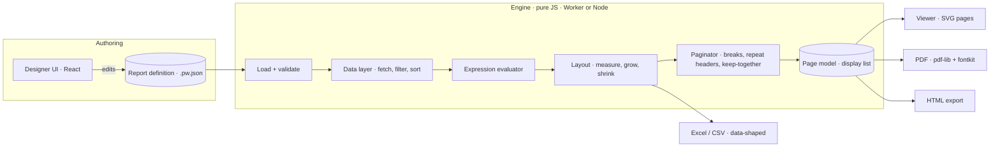

# Pagewright — Architecture and Roadmap

> Working name. Change it in one place later.
> Status: Phase 1 built — see PHASE1.md · 3 Oct 2026 · Owner: Arun · Stack: Next.js, JavaScript

---

## 1. Goal

Build a reporting product with the feature set of ActiveReportsJS:

- a visual **report designer** in the browser,
- a **report engine** that binds data and makes pages,
- an interactive **report viewer**,
- **exporters** for PDF, Excel, HTML and CSV.

We own the engine. We pay no per-domain license.

### Non-goals (for now)

- Import of ActiveReports `.rdlx-json` files. The format is JSON, so an importer is possible later (Phase 4+).
- Complex-script text (Arabic, Kannada, Hindi shaping). See risk R8.
- Database queries from the browser. Database sources go through a server route only.
- The AI assistant feature.

---

## 2. The decision that drives everything

**The engine is pure JavaScript. It has no React and no DOM.**

The engine takes a report definition and data. It returns a **page model**: a list of pages. Each page is a flat list of draw commands (text, rect, line, path, image, link) at absolute positions, in points.

Every output reads the same page model. The viewer draws it as SVG. The PDF exporter draws it with pdf-lib. So the viewer and the PDF always agree.

This decision has three consequences:

1. **The engine measures text with fontkit, not the DOM.** It uses the same font files that the PDF embeds. The widths are the same everywhere, so the line breaks and page breaks are also the same everywhere.
2. **Renderers never wrap text.** The engine breaks text into lines. A renderer only draws the lines it gets. This rule is not optional.
3. **The engine runs in a Web Worker and in Node.** The browser stays responsive. A Next.js route can also render PDFs on the server, for batch jobs. ActiveReportsJS runs in the browser; on a server it needs a headless browser (its own documentation says so).

---

## 3. System diagram



Excel and CSV read the **layout tree**, not the page model. A spreadsheet needs rows and typed cells. It does not need boxes at x/y positions.

---

## 4. Report definition

The definition is JSON with a version number. The unit is the **point** (1/72 inch). The designer shows inches, centimetres or millimetres, as the user chooses.

```json
{
  "$schema": "pagewright/report@1",
  "name": "Loan statement",
  "page": { "size": "A4", "orientation": "portrait", "margins": [36, 36, 36, 36] },
  "parameters": [
    { "name": "accountId", "type": "string", "prompt": "Account", "required": true }
  ],
  "dataSources": [
    { "name": "loans", "type": "rest", "url": "/api/loans/{Parameters.accountId}", "method": "GET" }
  ],
  "dataSets": [
    {
      "name": "Payments", "source": "loans", "path": "$.payments",
      "fields": [
        { "name": "dueDate", "type": "date" },
        { "name": "amount",  "type": "number" },
        { "name": "status",  "type": "string" }
      ],
      "filters": [], "sort": [{ "by": "=Fields.dueDate", "dir": "asc" }]
    }
  ],
  "styles": { "base": { "font": "Inter", "size": 9, "color": "#1a1a1a" } },
  "sections": {
    "pageHeader": { "height": 48, "items": [] },
    "body":       { "items": [ { "type": "table", "dataSet": "Payments", "...": "..." } ] },
    "pageFooter": { "height": 28, "items": [
      { "type": "textbox", "x": 0, "y": 8, "w": 523, "h": 14, "align": "right",
        "value": "Page {Globals.PageNumber} of {Globals.TotalPages}" }
    ] }
  }
}
```

Two expression forms:

- A property value that starts with `=` is one expression: `"=Sum(Fields.amount)"`.
- A text value can hold `{ … }` parts: `"Due on {Format(Fields.dueDate, 'dd MMM yyyy')}"`.

### Report items

| Item | What it does | Phase |
|---|---|---|
| TextBox | Static or bound text, can grow / can shrink | 1 |
| Image | URL, embedded, or bound to a field | 1 |
| Line, Shape | Lines, rectangles, rounded rectangles, ellipses | 1 |
| Table | Header, detail, footer rows; repeat header on each page | 1 |
| Table groups | Multi-level group header/footer rows, subtotals | 2 |
| List | Repeats a free-form container for each record or group | 2 |
| Container | Groups items; page break before/after | 2 |
| CheckBox | Bound boolean | 2 |
| Chart | Column, bar, line, area, pie/donut, scatter; since parity Phase 5 also bubble, radar, polar, candlestick, OHLC, gauge, funnel, combos, 100% stacks, ranges, two value axes, trend/reference overlays, label templates, palettes | 3, P5 |
| Tablix (matrix) | Row groups and column groups (pivot) | 3 |
| Subreport | Embeds another report with parameters | 3 |
| Barcode | Code 128, EAN-13, QR | 3 |
| Sparkline, Bullet, Data bar, Icon set, Range bar | Small in-cell charts (sparklines: line, column, area, win/loss, range band) | 3, P5 |
| Table of contents | Built from bookmarks | 4 |
| Fixed-page layout | Designed pages for forms (invoice templates) | 4 |

Every item type is one **registry entry**:

```js
registry.register('textbox', {
  props: { /* schema: type, editor, default, category, allowsExpression */ },
  layout(item, ctx) { /* returns measured boxes */ },
  designer: TextBoxDesigner,   // React, lives outside src/engine
});
```

To add a new item type, you add one registry entry. You do not touch the paginator, the exporters or the inspector.

---

## 5. Expression language

The engine has its own lexer, Pratt parser and evaluator. **It never uses `eval` or `new Function`.** Report files can come from users, so this is a security boundary.

| Group | Contents |
|---|---|
| Values | numbers, strings, dates, booleans, `null` |
| Operators | `+ - * / %`, `& ` (string concat), `= <> < <= > >=`, `And Or Not` |
| Scopes | `Fields.x`, `Parameters.x`, `Globals.PageNumber`, `Globals.TotalPages`, `Globals.ExecutionTime`, `ReportItems.name` |
| Logic | `IIF`, `Switch`, `IsNull`, `Coalesce` |
| Text | `Format`, `Upper`, `Lower`, `Left`, `Right`, `Mid`, `Len`, `Trim`, `Replace` |
| Math | `Round`, `Abs`, `Floor`, `Ceiling`, `Min`, `Max` |
| Date | `Now`, `Today`, `DateAdd`, `DateDiff`, `Year`, `Month`, `Day` |
| Aggregates | `Sum`, `Avg`, `Count`, `CountDistinct`, `Min`, `Max`, `First`, `Last` (each takes an optional scope name) |
| Running | `RunningValue`, `RowNumber` |

Rules:

- An aggregate uses the nearest scope: the current group, then the data region, then the data set. This is the same rule as RDL, so ActiveReports users feel at home.
- Formats use `Intl` with .NET-style strings: `C2`, `N0`, `P1`, `dd MMM yyyy`. A locale setting controls them (default `en-IN`, so lakh grouping works).
- `PageNumber` and `TotalPages` exist only after pagination. The validator allows them in the page header and page footer only.

---

## 6. Data layer

| Source | How | Phase |
|---|---|---|
| Inline JSON | Stored in the definition | 1 |
| REST | GET/POST, headers, query values from parameters | 1 |
| CSV | Inline or by URL | 2 |
| GraphQL | REST POST with a query body | 3 |
| OData | REST with `$filter`, `$select` | 3 |
| Database | Server route with an adapter (Postgres, MySQL). Credentials never reach the browser. | 4 |

- A data set has a path (a small JSONPath subset), a typed field list, calculated fields (expressions), filters and sort.
- Grouping is part of the **data region** (table, list, chart), not the data set. Two regions can group the same data in different ways.
- REST calls go through `/api/data/proxy` when CORS or secret headers need it. The proxy has a **host allowlist**. It blocks private IP ranges, and it has a timeout and a size limit (see risk R6).
- The data layer caches results for one render, so two regions on one data set fetch once.

---

## 7. Layout engine

Input: the definition plus resolved data. Output: a **layout tree** of measured boxes.

- **Text.** fontkit gives glyph advances. The engine wraps words, breaks a word that is too long, and applies alignment, vertical alignment, padding, and an optional ellipsis.
- **Can grow / can shrink.** When an item grows by Δ, every item below it whose x-range overlaps moves down by Δ. The engine sorts items by top and sweeps once. This is the RDL "push" rule.
- **Table.** Columns have fixed widths. A row is as tall as its tallest cell. Header, group header, detail, group footer and footer rows are separate box types, so the paginator knows what each row is.
- **Visibility.** A hidden item takes no space. A drill-down toggle hides or shows rows before pagination.

---

## 8. Paginator — the hardest part

Most clones fail here. We design this first and we test it hardest.

Content height = page height − top and bottom margins − page header − page footer.

The paginator walks the layout tree from top to bottom. It keeps a cursor `y`. For each block:

1. If the block has *page break before*, start a new page.
2. If the block fits, place it.
3. If it does not fit, and it is atomic or *keep together*, and it is shorter than one page: start a new page and place it there.
4. If it still does not fit, **fragment** it:
   - A table breaks between rows. It breaks inside a row only when that row is taller than a full page; then it splits the text lines of that row.
   - On a new page, the paginator repeats header rows that have *repeat on new page*.
   - A group header with *keep with next* moves to the next page when no detail row fits after it (no orphan headers).
5. If the block has *page break after*, start a new page.

**Page-dependent text.** The page header and footer have a fixed height, so `TotalPages` cannot change the layout. Pass 1 paginates. Pass 2 fills in the header and footer text. Two passes are always enough.

**Drill-down.** A toggle changes visibility in the layout tree, then the paginator runs again. There is no new data fetch, so it is fast.

Each paginator bug becomes a **golden test** (definition + data → expected page model) before we fix it.

---

## 9. Page model

```js
{
  pages: [{
    width: 595.28, height: 841.89,          // A4 in points
    items: [
      { t: 'text',  x, y, w, h, lines: [{ x, y, runs: [{ text, font, size, color, weight, style }] }] },
      { t: 'rect',  x, y, w, h, fill, stroke, strokeWidth, radius },
      { t: 'line',  x1, y1, x2, y2, stroke, strokeWidth, dash },
      { t: 'path',  d, fill, stroke, strokeWidth },          // charts, shapes
      { t: 'image', x, y, w, h, src, fit },
      { t: 'link',  x, y, w, h, href | bookmark | drill },   // interactivity
    ],
  }],
  bookmarks: [{ label, page, y, children: [] }],
  fonts: ['Inter-Regular', 'Inter-Bold'],
}
```

Charts and barcodes also produce only `path`, `rect`, `line` and `text`. So every exporter supports them with no extra code.

---

## 10. Renderers and exporters

| Output | How | Phase |
|---|---|---|
| Viewer | One SVG per page, in a virtualized list. Same font files through `@font-face`. | 1 |
| PDF | pdf-lib + fontkit. Subset-embedded fonts, vector shapes, links, outline from bookmarks. | 1 |
| Server PDF | `/api/render/pdf` runs the engine in Node. | 3 |
| HTML | One self-contained file, one absolute-positioned block per page. | 3 |
| Excel | ExcelJS in **data mode**: one sheet per table, typed cells, number formats, group outline levels. | 3 |
| CSV | One file per data region. | 3 |
| Print | HTML render + `@page` CSS. | 3 |
| PNG | SVG → canvas in the browser. | 4 |

---

## 11. Designer

```
┌────────────────────────────────────────────────────────────────┐
│ File  Edit  Insert  View      ↶ ↷     75% ▾      [Design|Preview]│
├────────────┬──────────────────────────────────────┬────────────┤
│ Toolbox    │  ┌ ruler ───────────────────────┐    │ Properties │
│  TextBox   │  │                              │    │  Layout    │
│  Table     │  │      paper canvas            │    │  Text      │
│  Image …   │  │   (page header / body /      │    │  Border    │
│────────────│  │    page footer bands)        │    │  Data      │
│ Data       │  │                              │    │  Visibility│
│  ▸ loans   │  └──────────────────────────────┘    │            │
│    ▸ Payments                                     │            │
│      amount│                                      │            │
└────────────┴──────────────────────────────────────┴────────────┘
```

- **State.** A Zustand store holds the definition and the selection. Every edit is an immer patch, so undo and redo come for free.
- **Canvas.** DOM elements sit at absolute positions on a scaled paper. You can select, multi-select (Shift, or drag a marquee), move, resize with handles, nudge with the arrow keys, and snap to a grid. Smart guides arrive in Phase 4.
- **Inspector.** The inspector builds itself from the item's prop schema. Any prop that allows expressions shows an `fx` button.
- **Data explorer.** It shows sources, data sets, fields and parameters. Drag a field onto the canvas to create a bound TextBox. Drag it onto a table cell to bind that cell.
- **Expression editor.** CodeMirror 6 with completion for `Fields`, `Parameters` and functions. It is lighter than Monaco.
- **Preview.** The engine runs in a Web Worker, and the viewer shows the result.
- **Save and load.** `/api/reports/[id]` stores JSON files in `reports/` in Phase 1, and a database later.

---

## 12. Viewer

- **Toolbar:** first / previous / next / last, page box, zoom (fit width, fit page, %), search, export menu, print.
- **Panels:** parameters (types, defaults, required, multi-value; cascading in Phase 3), document map from bookmarks.
- **Interactivity:** drill-down toggles, drill-through (open another report with parameters), interactive sort on column headers, hyperlinks.
- **Embedding:** `<ReportViewer definition={…} parameters={…} />` for React, and `mountViewer(element, options)` for plain JS (Phase 4).

---

## 13. Project layout

```
pagewright/
├─ app/
│  ├─ page.js                        # report list
│  ├─ designer/[id]/page.js
│  ├─ viewer/[id]/page.js
│  └─ api/
│     ├─ reports/[id]/route.js       # load / save definitions
│     ├─ data/proxy/route.js         # REST proxy with allowlist
│     └─ render/[format]/route.js    # server PDF / XLSX (Phase 3)
├─ src/
│  ├─ engine/                        # NO React, NO DOM — an ESLint rule enforces this
│  │  ├─ schema/                     # schema, validation, version migrations
│  │  ├─ expr/                       # lexer, parser, evaluator, functions, formats
│  │  ├─ data/                       # sources, data sets, grouping, aggregates
│  │  ├─ text/                       # fontkit measurement, line breaking
│  │  ├─ items/                      # registry + one layout function per item type
│  │  ├─ paginate/                   # the paginator
│  │  └─ index.js                    # render(definition, options) → page model
│  ├─ exporters/                     # pdf, html, xlsx, csv
│  ├─ viewer/                        # React viewer + SVG page renderer
│  ├─ designer/                      # React designer
│  └─ worker/                        # Web Worker wrapper for the engine
├─ fonts/                            # bundled OFL fonts: Inter, IBM Plex, Noto Sans
├─ reports/                          # sample definitions + sample data
└─ tests/
   ├─ engine/                        # Vitest unit tests
   └─ golden/                        # definition + data → page-model snapshots
```

**Language:** JavaScript, as you chose. I recommend one addition: `// @ts-check` with JSDoc types in `src/engine/` only. It catches type bugs in the engine with no TypeScript build step. The UI stays plain JS.

**Main dependencies:** `next`, `react`, `zustand`, `immer`, `pdf-lib`, `@pdf-lib/fontkit`, `fontkit`, `exceljs`, `@codemirror/*`, `vitest`, `playwright`. Exact versions get pinned when we scaffold.

---

## 14. Roadmap

Effort is in **focused dev-days**. Each phase ends with an exit test. Phase N+1 work does not start until the Phase N exit test passes.

### Phase 1 — Core · 10–14 days

| Area | Deliverables |
|---|---|
| Foundations | Next.js scaffold, ESLint engine boundary, schema v1, fontkit text measurement, page model, SVG renderer |
| Engine | Expression language (core functions), JSON + REST sources, data sets (fields, filters, sort), layout for TextBox / Image / Line / Shape / Table, can grow, paginator with repeated table headers, page header / footer, `PageNumber` / `TotalPages` |
| Designer | Paper canvas with bands, toolbox, select / move / resize, grid snap, inspector, data explorer with drag-to-bind, basic table editor, undo / redo, save / load, preview |
| Viewer | Paging, zoom, PDF export |

**Exit test:** build a *Loan statement* in the designer without editing JSON. It has a header, a customer block, a 300-row payment table over several pages with a repeated header, totals, and "Page X of Y". The viewer and the PDF match line for line.

### Phase 2 — Data power · 8–10 days

- Table groups (multi-level), group headers and footers, subtotals, aggregates by scope, `RunningValue`, `RowNumber`
- Parameters (types, defaults, required, multi-value) and the parameter panel
- Conditional formatting (expressions on any style prop), named styles
- Keep together, keep with next, page break before / after a group
- List, Container and CheckBox items
- CSV source, calculated fields

**Exit test:** a *Sales by region* report with two group levels, subtotals, a grand total, and a year parameter that filters the data.

### Phase 3 — Output and interactivity · 10–14 days

- Charts (bar, column, line, area, pie / donut, scatter; axes, legend), drawn as page-model primitives
- Tablix / matrix with column groups
- Subreports, barcodes, sparklines, bullets
- Excel, HTML and CSV export; server render route
- Drill-down, drill-through, bookmarks and document map, hyperlinks, interactive sort, search
- GraphQL and OData sources, cascading parameters

**Exit test:** a summary report with a chart and a matrix, drill-down from region to city, and export to all formats from both the browser and the server route.

### Phase 4 — Product polish · 8–12 days

- Smart guides, align / distribute tools, copy / paste, a full keyboard map, rulers
- Embeddable designer and viewer, a plain JS mount API, an npm package build
- Fixed-page reports, multi-column layout, table of contents
- Themes, viewer UI i18n
- Database storage for reports, versions, permissions (only if multi-user)
- Performance: 50,000 rows in under 5 s in a worker; the first page shows before the last page is done
- Optional: an `.rdlx-json` importer (subset)

**Exit test:** embed the viewer in a separate Next.js host app with three lines of code.

### Total

**About 36–50 focused dev-days.** Part-time, that is two to three months. Phase 1 alone gives a usable product.

---

## 15. Feature parity map

Updated 4 Oct 2026 after Phases B and C (`docs/PLAN-PHASE-BC.md`).

| ActiveReportsJS feature | Pagewright | Where |
|---|---|---|
| Standalone desktop designer | Web designer only (no desktop app) | — |
| Embeddable designer component | Yes | Phase 4 |
| Report viewer | Yes; draws only the pages near the one in view | Phase 1, C5 |
| Continuous-page (RDL) reports | Yes | Phase 1 |
| Fixed-page reports | Yes | Phase 4 |
| Pageless and dashboard reports | Yes: `Pageless` page size, dashboard template | B3 |
| Table / Tablix / List / Banded list | Table, List, Tablix (matrix), banded via List + Container | Phases 1–3 |
| Chart, Sparkline, Bullet | Yes; the chart types and options of ActiveReportsJS 6 since parity Phase 5 | Phase 3, P5 |
| Map | Yes: choropleth from your GeoJSON, sized points | B4 |
| Barcode | Code 128, EAN-13, QR and others | Phase 3 |
| Subreport | Yes (at most 2,000 per render) | Phase 3 |
| Input field (fillable PDF) | Yes: text, multi-line, check box, choice | B2 |
| Parameters (multi-value, cascading) | Yes | Phases 2–3 |
| Drill-down, drill-through, interactive sort | Yes | Phase 3 |
| REST, JSON, CSV, GraphQL | Yes | Phases 1–3 |
| OData | As a REST source | — |
| Databases | Yes, on the server: SQLite, Postgres, MySQL; read-only, bound parameters, saved queries only from the browser | C1 |
| PDF, HTML, Excel, CSV export | Yes | Phases 1–3 |
| PDF/A, digital signatures | Yes: PDF/A-2b (veraPDF passes), detached PKCS#7 signatures | C4 |
| Import ActiveReports `.rdlx-json` | See STATUS | B1 |
| Server-side rendering | **Yes. ActiveReportsJS needs a headless browser for this.** | Phase 3 |
| Automation API (batches, schedules, webhooks) | **Yes. ActiveReportsJS has none.** | Phase 4 |
| User accounts and roles | Yes: viewer, designer, admin (`PW_AUTH=users`) | C2 |
| AI assistant | Yes: draft a report from a description (Claude) | C3 |
| Themes, i18n | Yes | Phase 4 |

---

## 16. Risks

| # | Risk | Impact | Mitigation |
|---|---|---|---|
| R1 | Text widths differ between the viewer and the PDF | Different page breaks | One fontkit measurement; renderers never wrap text |
| R2 | Paginator edge cases (row taller than a page, nested groups) | Broken output | Golden snapshot suite from day 1; each bug becomes a golden test |
| R3 | Scope creep ("all features") | Nothing ships | Exit tests; no next-phase work early |
| R4 | Large data freezes the UI | Bad UX | Engine in a Web Worker; stream pages so the first page shows early |
| R5 | Expression injection | Security hole | Own parser; no `eval`; fixed function table |
| R6 | SSRF through the REST proxy | Security hole | Host allowlist, block private IP ranges, timeout, size limit |
| R7 | Font licensing | Legal risk | Bundle OFL fonts only; per-report font upload |
| R8 | Complex scripts (Kannada, Hindi, Arabic) | Wrong glyphs | Non-goal until Phase 4+. fontkit can shape some scripts, but it needs testing. Say so in the docs. |
| R9 | Tablix complexity | Phase 3 slips | Build it last in Phase 3; ship charts and exports first |

---

## 17. Decision log

| # | Decision | Why |
|---|---|---|
| D1 | The engine is pure JS and runs in Worker + Node | One engine for preview, export and server batch |
| D2 | The unit is the point (1/72 in) | Matches PDF; no conversion bugs |
| D3 | fontkit text measurement | The same widths everywhere |
| D4 | Page model display list; renderers never wrap | What you see is what prints |
| D5 | Own expression language | Security; RDL-like semantics |
| D6 | JS, with `// @ts-check` in the engine | Your preference, plus type safety where it matters |
| D7 | Zustand + immer patches | Undo / redo for free |
| D8 | CodeMirror 6 for expressions | Smaller than Monaco |
| D9 | RDL semantics (scopes, can-grow push) | ActiveReports users feel at home |
| D10 | Fonts embed in full in PDFs (Phase 1) | pdf-lib's subsetter drops Inter glyphs; replace the subsetter later |
| D11 | Growth under 1 pt does not push | Stops cascades of hair-line shifts |
| D12 | A repeated header shifts the whole continued page | Simple and predictable; revisit if side-by-side tables need it |

---

## 18. Open questions for Arun

1. **Name.** Keep "Pagewright"?
2. **First real report.** What should the Phase 1 exit sample be — a loan statement, a promotion summary, something else?
3. **Users.** One user, or several users with login and permissions?
4. **License.** Open source or private?
5. **Scripts.** Must reports show Kannada or Hindi text in Phase 1?
